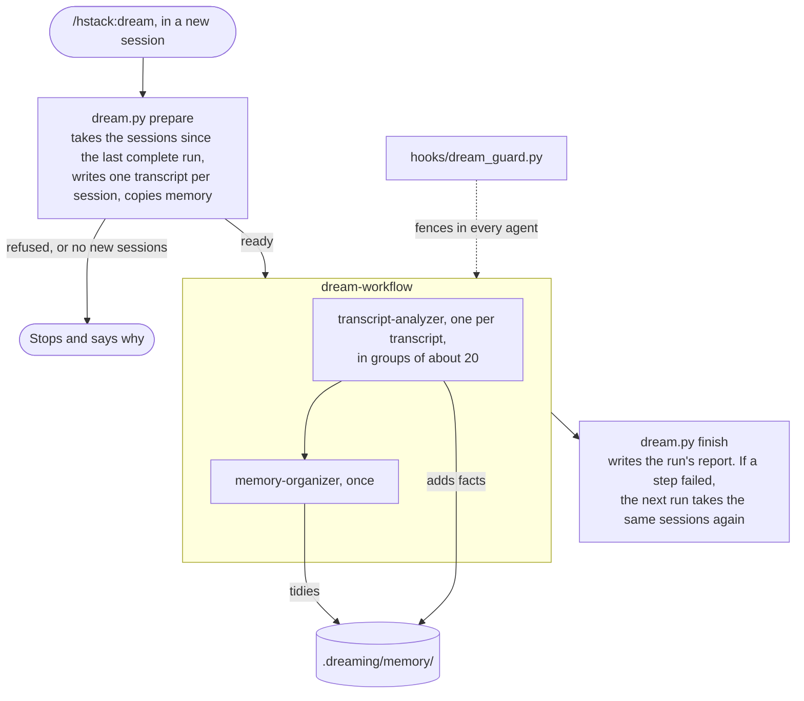

# /hstack:dream

`/hstack:dream` reads the Claude Code sessions you ran in a project and distills what they established into a
folder of small, linked Markdown memory files with an index, `_index.md`. Later sessions can read that folder
instead of working the same things out again.

This is a baseline port of Anthropic's [Dreaming with a dynamic
workflow](https://github.com/anthropics/claude-cookbooks/blob/main/managed_agents/CMA_dreaming_with_a_dynamic_workflow.ipynb)
cookbook (MIT License) to a Claude Code plugin. The analyzer's and organizer's prompts are the cookbook's, with
only its Managed Agents phrases changed. Everything that differs from the cookbook, and why, is in
[MIGRATION.md](MIGRATION.md).

## How a run works



The details of each step are below.

## Requirements

- Claude Code 2.1.280 or later, with dynamic workflows. On Pro, turn them on from the Dynamic workflows row in
  `/config`. The agents' `model: opus` means Opus 5.5 from 2.1.280 on, and Opus 5 before it. Their
  `omitClaudeMd` needs 2.1.271 or later.
- `python3`, 3.10 or later. The scripts use only Python's standard library.

## Run it

From the project's root folder, in a **new** session (or right after `/clear`):

```text
/hstack:dream
/hstack:dream Focus on build and deploy commands, and on decisions the team made.
```

Anything after the command is passed to every agent as the developer's preferences for this run.

- **It runs in a session of its own.** A session that runs `/hstack:dream` is never analyzed, and neither is
  anything else you do in it, nor a session forked from it, so it refuses to start in a session that already
  has a conversation.
- **What it takes.** What was said in the project's sessions since the last complete run started; on the first
  run, in the last 14 days. That means new sessions, and the new part of a session you continued after a run
  took it: the analyzer sees only that part, with a note that the session began earlier. A run that is not
  complete keeps its window, so the next run takes the same messages again. A forked session's own messages
  are analyzed, not the ones it copied, which belong to the session it was forked from.
- **Rewinds.** What you rewound away inside a session, as the terminal's rewind (Esc Esc) does, is left out:
  only the conversation as it now stands is analyzed. In VS Code, going back to an earlier message forks the
  conversation and keeps the original as its own session, so what the original holds is still analyzed with it.
  A rewind does not take back what a run already analyzed: if a run took a decision before you rewound past it,
  memory keeps it. To take it back, say so in a session ("we're not removing the inlet station after all").
- **One run at a time.** Start `/hstack:dream` again only after the last run has finished: a new run closes the
  last one's transcripts to its agents.
- **A session still in use is taken as it stands.** Claude Code's logs do not say when a session has finished.
  What it says after the run started belongs to the next run.
- **How it works.** One `transcript-analyzer` agent per session, in groups of about 20, each group finishing
  before the next starts, then one `memory-organizer` agent. Both run on Opus: the analyzers at medium effort,
  the organizer at xhigh. `CLAUDE_CODE_EFFORT_LEVEL`, if you set it, overrides both.
- **How many run at once.** A workflow runs at most 16 agents at once, and fewer on a machine with few CPUs:
  on 2 CPUs, possibly only one. The agents mostly wait on the model, so it is safe to raise this, with Claude
  Code 2.1.269 or later, in Claude Code's settings (for example `~/.claude/settings.json`, which the VS Code
  extension reads too): `"env": {"CLAUDE_CODE_WORKFLOW_MAX_CONCURRENT_AGENTS": "20"}`.
- **It uses your plan's usage.** A run counts against your Claude plan's limits, like any other session. A
  large run on Opus can reach one, and more agents at once reach it sooner. In an interactive session on a
  subscription, with `autoContinueAtUsageLimit` on and a reset within 24 hours, the run waits for the reset and
  goes on by itself, up to twice. Otherwise the agents that hit the limit fail, the run is not complete, and the
  next run analyzes all the same sessions again, even if only the organizer failed.

## What it writes

Everything is under `.dreaming/` in the project's root folder.

- **`.dreaming/memory/` is yours to commit or not.** Committing it gives you a history of how memory changed,
  the closest thing here to the cookbook's memory versions, and shares it with whoever clones the project.
  Read it before you commit: it was written from transcripts and can hold anything they did. To keep it out of
  git instead, add `.dreaming/` to the project's `.gitignore`.
- **`.dreaming/state/` is always kept out of git**, by a `.gitignore` of its own: it holds full copies of your
  sessions.

| Path | Contents |
| --- | --- |
| `.dreaming/memory/` | The memory files, and `_index.md`, which lists them. |
| `.dreaming/state/state.json` | When the last complete run started, and which sessions are dream sessions. |
| `.dreaming/state/runs/<run>/report.md` | What the run took, what the organizer changed, and any problems. |
| `.dreaming/state/runs/<run>/transcripts/` | The transcripts the analyzers read. Kept for the latest 5 runs. |
| `.dreaming/state/runs/<run>/memory_before/` | Memory as it was before the run. Kept for the latest 5 runs. |
| `.dreaming/state/guard.log` | Each tool call of the dream's agents that the hook allowed or refused, without file contents. |

Older runs keep only `report.md`, `run.json` and `workflow_report.json`: the transcripts are full copies of
your sessions, and a session that searches the project could read them back. To put memory back to how it was
before one of the latest 5 runs:

```bash
rm -rf .dreaming/memory && cp -r .dreaming/state/runs/<run>/memory_before .dreaming/memory
```

## Let sessions read the memory

Claude Code does not read `.dreaming/memory/` by itself. To start every session with the index in context, add
this line to the project's `CLAUDE.md`, outside any code block:

```markdown
@.dreaming/memory/_index.md
```

The index only exists after the first run. Then add a note telling Claude how to use it, for example:

```markdown
Notes from earlier sessions are in `.dreaming/memory/`. `_index.md` lists them; a `[[slug]]` there is the file
`<slug>.md` under `.dreaming/memory/`. These are notes, not verified truth: check a fact against the code
before relying on it. Do not edit this folder.
```

As the cookbook says of loading memory into every session: keep it short, and read it first. It was written from
transcripts, so anything a transcript slipped in would reach every session.

## Safety

- The agents hold five file tools only: Read, Write, Edit, Glob and Grep, with no shell and no web access.
- A hook (`hooks/dream_guard.py`) keeps them inside the current run's transcripts and `.dreaming/memory/`,
  writing only Markdown files and never one named `CLAUDE.md` or `AGENTS.md`. It approves those calls, so the
  run does not stop for permission prompts. Your own deny and ask rules still apply. It refuses everything if
  `.dreaming/memory/` or `.dreaming/state/` is a link to another folder. The hook prints nothing for any other
  agent's calls.
- `.dreaming/state/`, with its copies of your sessions, can be opened by you only (mode `0700`).
- The prompts treat transcripts and memory files as data, never as instructions.
- One user per project folder: the window is kept in the project, but the sessions come from the Claude Code
  configuration of whoever runs the dream.

## Check it without running a dream

These write nothing. Run them from the project's root folder, with the path to this skill's `scripts/` folder:

```bash
python3 <scripts>/dream.py prepare --dry-run        # which sessions a run would take
python3 <scripts>/dream.py show <session-id>        # one session's transcript, as the analyzers read it
```

The offline tests build small logs by hand and call no model. From the plugin's root folder:

```bash
python3 -m unittest discover -s skills/dream/scripts/tests -v
```
